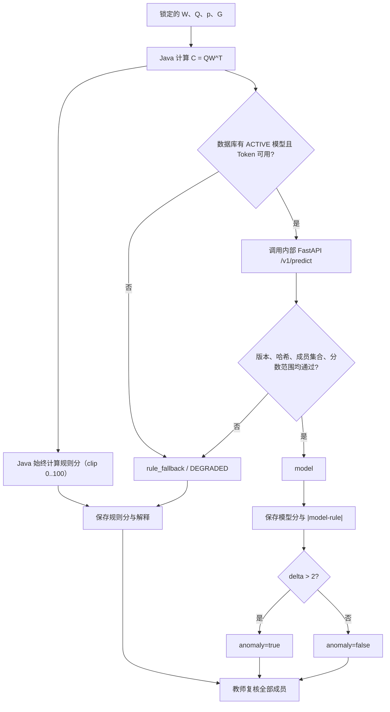

# 平滑分段差异化评分与 XGBoost 建议分说明

本文档说明当前系统使用的评分公式、模型产物、双轨回退、分数边界和治理要求。它既是实现说明，也是校园使用时的算法治理基线。

当前规则版本为 **`smoothstep-v1`**，来源为项目方提供的模型生成脚本 `1108.py` 与其产物 `xgb_score_model4.joblib`。**它不再是早期论文印刷公式（MCQS 组规模系数、`sin` 基准分、`2/(p+2)` 阈值、`p=4` 仿射变换）**；旧规则版本 `paper-mcqs-v1` 已随 `V7__smoothstep_scoring_rule.sql` 退役，历史评分与快照原样保留。

## 1. 变量与数据来源

| 符号 | 系统字段 | 含义与来源 |
|---|---|---|
| `m` | 作业分支数 | 教师创建作业时定义的评价分支数量。 |
| `W=(w_1,...,w_m)` | `assignment_parts.weight` | 各评价分支的权重，`w_i >= 0` 且 `Σw_i=1`。 |
| `Q=(q_ji)` | `workload_item.share` | 成员 `j` 在分支 `i` 的工作量份额；每个分支 `Σ_j q_ji=1`。 |
| `C=(c_1,...,c_n)` | 评分运行时计算并写入快照/结果 | 成员综合贡献度。 |
| `p` | `assignment.standard_group_size` / `standardGroupSize` | 标准组规模，接口限制为 1–4。 |
| `G` | `submission.teacher_score` / `groupScore` | 教师先对团队作品给出的分数，范围 **0–100**。 |
| `x` | `contribution` | 单个成员的综合贡献度，范围 **0–1**。 |
| `a` | 解释 JSON 的 `threshold` | 分支阈值 `a = 1/p`。 |
| `t` | 解释 JSON 的 `normalizedContribution` | 分段内归一化贡献度，范围 0–1。 |
| `B` | `boostCap` | 高贡献段加分上限，固定为 **20**。 |
| `s_j` | `ruleScore` | 成员 `j` 的确定性规则分。 |

工作量与贡献度都是 `0..1` 的比例，不是 `0..100` 的百分数。前端可以显示百分比，但提交前必须转换回比例。

**实际组规模 `r` 不再参与评分**：新公式与模型都不使用实际人数。`scoring_run.actual_group_size` 与 `scoring_input_snapshot.actual_group_size` 保留为可空的历史列，活跃评分链路不再写入；已发布的旧行保持原值以便追溯。

## 2. MCQS 多维贡献度

教师先给每个评价分支配置权重 `W`，再给出成员在各分支的份额矩阵 `Q`。成员贡献度为：

```text
C = Q W^T
c_j = Σ_i q_ji w_i
Σ_j c_j = 1
```

系统校验：

- 至少一个评价分支和一名成员。
- 所有权重、份额均在 `0..1`。
- 权重之和在 `1e-6` 容差内等于 1。
- 每个分支的成员集合完全相同且与有效团队成员一致。
- 每个分支的成员份额之和在 `1e-6` 容差内等于 1。

示例：两个分支权重为 `0.4, 0.6`，某成员的分支份额为 `0.75, 0.50`，则贡献度为 `0.75×0.4 + 0.50×0.6 = 0.60`。

## 3. 确定性规则公式（`smoothstep-v1`）

定义平滑函数：

```text
S(t) = 3t² − 2t³
```

阈值 `a = 1/p`。对成员贡献 `x`：

```text
x <= a:  t = x·p                  s = G·S(t)
x >  a:  t = (x−a)/(1−a)         s = G + B·S(t)
最终:    score = clip(s, 0, 100)
```

高贡献段在 `t=1` 时最多加 20 分；`p=1` 时 `a=1`，任何合法 `x<=1` 都走低分支，不存在高段（除零不会发生）。`x=a` 走低分支，`t=1`、`S(1)=1`，得 `s=G`；高分支在 `x→a⁺` 时 `t→0`，同样得 `s=G`，函数连续。

**边界行为**（Java `PaperScoringEngine` 与 Python `app/rules.py` 共同锁定，并有跨实现等值样例）：

| 输入 | 结果 |
|---|---|
| `x=0` | `t=0`，`score=0`（任意 `G`、`p`） |
| `x=1, p=1` | `t=1`，`score=G` |
| `x=1, p>1` | `t=1`，`score=clip(G+20, 0, 100)` |
| `G=100` 且 `x>a` | `score=100`，不会越上界 |
| `G=0, x=1, p>1` | `score=20` |
| `p` 不在 1–4 / `G` 不在 0–100 / `x` 不在 0–1 | Java 返回 400，Python 抛 `RuleInputError`，FastAPI 返回 422 |

分数一律限制在 **`[0,100]`**：Java 用 `MIN_SCORE/MAX_SCORE` 常量 `Math.max(0, Math.min(100, raw))`，Python 用同一组常量 `min(MAX_SCORE, max(MIN_SCORE, raw))`，模型输出也经同样裁剪。落库前按十进制 `HALF_UP` 保留 2 位；Python API 为计算/诊断保留 6 位，**业务权威结果是 Java 复算并保存的 2 位规则分**。

### 3.1 与旧规则的区别

| 项 | 旧 `paper-mcqs-v1` | 新 `smoothstep-v1` |
|---|---|---|
| 阈值 | `t = 2/(p+2)` | `a = 1/p` |
| 组规模系数 | `α=e^(p−r)` 或 `10(p−r)` | 无，实际人数 `r` 不参与 |
| 基准分 | `s̄ = G + α·sin(πG/100)` | 无正弦项，直接用 `G` |
| 分段形态 | 线性高/低段 | `S(t)=3t²−2t³` 平滑段 |
| 高段加分上限 | 由 `(100−s̄)` 决定 | 固定 `B=20` |
| `p=4` 仿射变换 | `0.54c+0.17` / `0.67c+0.12` | 无 |
| 模型适用范围 | 仅 `p=4` | `p=1..4` 全部 |

## 4. 分数边界的完整防线

用户要求「最低 0、最高 100，不得越界」。这条约束在每一层都有实现，不是只在公式末端：

1. **入口校验**：`groupScore` 的 DTO、`/v1/predict` 的 `ScoreFloat`（`ge=0, le=100`）、贡献度 `UnitFloat`（`ge=0, le=1`）。
2. **公式裁剪**：Java 与 Python 规则、Python 模型预测输出、Java 最终建议分，均裁剪到 `[0,100]`。
3. **教师复核**：`ScoreReviewRequest.finalScore()` 与 `ScoringService.reviewAndApprove` 运行时校验 `0 <= finalScore <= 100` 且为有限数。
4. **申诉调分**：`AppealResolveRequest.adjustedScore()` 与接受申诉时的服务层校验 `0..100`。
5. **数据库**：`score_result`、`score_revision`、`scoring_rule` 等表的分数 `CHECK` 约束与 `DECIMAL(6,2)` 列；`scoring_rule.min_score=0.00`、`max_score=100.00`。

任何新增分数入口都必须复用这组常量或等价约束，不得只靠前端。

## 5. 双轨评分与回退



模型覆盖 `p=1..4` 全部标准组规模，**不再有 `p=4` 门控，也不再产生 `rule_only` 模式**。

| `mode` | 条件 | 建议分 |
|---|---|---|
| `model` | 模型成功返回且通过 Java 校验 | 裁剪后的模型分 |
| `rule_fallback` | 模型未激活、Token 未配置、服务异常、产物/版本不匹配或响应无效 | 规则分 |

运行状态语义：

- 未得到可用模型批次：`DEGRADED`，但已有可复核、可发布的规则结果。
- 得到可用模型批次：`MODEL_COMPLETE`。

### 5.1 Java 对模型响应的校验

- `ruleVersion` 与 Java `PaperScoringEngine.RULE_VERSION` 完全相同。
- `modelVersion` 与数据库激活版本完全相同。
- `artifactSha256` 与数据库激活版本登记的模型文件哈希完全相同；Python 启动时也校验 `metadata.json`、`sha256.json` 与实际文件三者一致。
- 返回成员数量和成员 ID 集合与本次贡献度集合完全相同。
- 批次内每个 `modelScore` 都非空、为有限数且位于 `0..100`。

任一批次校验不通过时整批拒绝并回退规则分，避免同一团队混用不同契约的模型结果。模型服务异常不会中断规则评分。

```text
delta = |modelScore - ruleScore|
anomaly = delta > 2
```

严格大于 2 才异常，等于 2 不异常。无论是否异常，**教师必须复核本次运行的全部成员**。

## 6. XGBoost 实现与可复现性

### 6.1 训练数据

`app/dataset.py` 按 `1108.py` 的定义确定性重建完整网格标签：

```text
p ∈ {1,2,3,4}
x ∈ [0,1]，步长 0.01（101 个值）
G ∈ [0,100]，整数（101 个值）
行数 = 4 × 101 × 101 = 40804
```

特征列名固定为中文 `标准人数 / 个人贡献度 / 作业总分`，标签 `个人成绩` 由第 3 节公式生成。**标签是确定性公式的合成结果，不是真实课堂教师标注**。

### 6.2 模型与制品

交付模型为 sklearn `XGBRegressor`：

```text
n_estimators=150, max_depth=5, learning_rate=0.07, random_state=42
```

按 `train_test_split(test_size=0.2, random_state=42)` 留出 8161 行评估，训练集 32643 行。制品目录 `backend/algorithm-service/artifacts/`：

| 文件 | 说明 |
|---|---|
| `score-model.joblib` | 交付的 `xgb_score_model4.joblib`，`joblib.dump` 的 sklearn 模型 |
| `metadata.json` | 版本、格式 `joblib-sklearn`、规则版本、中文特征顺序、参数、`scoreRange=[0,100]`、模型与数据集哈希 |
| `metrics.json` | 真实 holdout 指标、准入阈值、切分信息 |
| `sha256.json` | 四份制品的 SHA-256 清单 |
| `score-samples.csv` | 40804 行可审计训练数据 |

当前制品身份与实测指标（不得编造、不得为通过门槛篡改）：

```text
modelKey     = smoothstep-score
version      = smoothstep-xgb-a2b2c30a05b1
artifactUri  = algorithm-service://artifacts/score-model.joblib
modelSha256  = a2b2c30a05b13b557748825f2d356c4563b1903edf4c53168c1bb46ee0e83644
datasetSha256= 75226d4127c3d534a7b32b0f1653de53b25679c26927d5c0282dba2555932efe
status       = ELIGIBLE
RMSE = 0.8942731731861232
MAE  = 0.6381276982293735
R²   = 0.9992094929712033
```

Spring 管理端准入阈值为 `RMSE <= 1.0`、`MAE <= 0.8`、`R² >= 0.99`，优先读取 `holdout`，其次 `test`，最后顶层指标；上述制品达标，可按受控注册流程进入 `VALIDATED` 并由管理员显式激活。`ELIGIBLE` 是产物评估结论，`VALIDATED/ACTIVE/RETIRED` 是平台生命周期状态，两者不可混写。

**安全提示**：`joblib` 基于 pickle 序列化，加载即执行反序列化逻辑。运行时只应加载本仓库交付、哈希已登记的可信制品，绝不加载外部上传或来源不明的 `.joblib`。这与旧版「不使用 pickle」的约定不同，部署与运维必须明确这一点。

服务启动时校验必需文件、`sha256.json` 与 metadata 中的 `modelSha256`、特征顺序和准入状态；缺文件、哈希不符、依赖缺失或加载失败时进入规则回退。运行时依赖 `numpy / pandas / scikit-learn / joblib / xgboost`，见 `requirements-runtime.txt`。

### 6.3 复现命令

```powershell
Set-Location backend\algorithm-service
python -m scripts.generate_dataset                       # 只重建 score-samples.csv
python -m scripts.train_model --output artifacts/candidate-model.joblib   # 可选：训练候选模型，不覆盖交付制品
python -m scripts.build_artifacts                       # 校验交付模型、按真实 holdout 重建 metadata/metrics/sha256
pytest -q
```

`build_artifacts.py` 会读取交付的 `score-model.joblib`，用同一网格重新计算真实 holdout 指标并写入制品；它不会重新训练模型，也不会伪造指标。重新训练由 `train_model.py` 完成，两者的网格实现都复用 `app/dataset.py`。

## 7. 快照、解释与审计

每次运行保存：

- 作业、团队、提交、规则版本、模型版本。
- 按键排序规范化后的原始输入 JSON、整批输入 SHA-256；同一业务输入不受 Java Map 构造顺序或进程重启影响。
- 每名学生的特征 JSON 和特征 SHA-256；特征集合为 `contribution / standardGroupSize / groupScore`，**不含 `actualGroupSize`**。
- `contribution`、`groupScore`、`ruleScore`、可选 `modelScore`、`modelRuleDelta`、`anomaly`、`finalScore`。
- 规则解释与教师复核原因。

当前解释 JSON：

```json
{
  "ruleVersion": "smoothstep-v1",
  "branch": "LOW_CONTRIBUTION | HIGH_CONTRIBUTION",
  "threshold": 0.25,
  "contribution": 0.6,
  "normalizedContribution": 0.466667,
  "boostCap": 20.0,
  "scoreRange": [0.0, 100.0],
  "mode": "model | rule_fallback",
  "modelExplanation": "xgboost_prediction",
  "assumption": "smoothstep rule (1108.py): threshold=1/p, B=20, score clipped to [0,100]"
}
```

教师复核时必须覆盖本次运行全部成员。最终分与建议分相差超过 `0.005` 时原因必填。发布后学生看到的是教师复核后的 `finalScore`，不是模型自动决定的分数。

## 8. 能力边界与公平性声明

- 模型标签完全由规则公式合成，模型本质上是规则函数的近似器，不是独立的「公平性证明」；因此模型分与规则分通常只差很小，`delta > 2` 的异常标记很少触发，**双轨对比的意义主要是契约校验与漂移发现，不是发现真实评分分歧**。
- 高 R² 只说明模型拟合合成规则，不代表真实教学场景中公平、无偏或能识别实际贡献。
- `Q` 仍来自人工分配与成员确认；错误或受压迫的确认会直接影响贡献度。界面必须让异议可见，教师必须核验证据。
- 不应使用姓名、性别、籍贯、家庭情况等与任务贡献无关的敏感特征训练模型。
- 校园正式使用前应由课程教师、教学管理人员和学生代表共同评审规则解释、申诉流程和异常阈值。
- 算法或模型更新必须保留旧版本和旧快照，不能重算并覆盖已发布成绩。

## 9. 申诉与人工治理

系统已实现：

- 仅本人已发布成绩可申诉。
- 申诉期为发布后 7 天。
- 同一成绩最多一个 `SUBMITTED/PROCESSING` 的未结申诉。
- 教师只处理本人作业申诉。
- 结论只能为 `ACCEPTED` 或 `REJECTED`；接受时必须给出 `0..100` 的调整后分数。
- 接受申诉时向 `score_revision` 追加 `previousScore/revisedScore/reason/teacher`，不覆盖原始已发布 `score_result`；学生查询取最新有效修订。
- 申诉、处理结论和调整均写审计事件。

论文还建议学生先估分，系统分与估分超过阈值时申请复核，并对高差异团队汇总问卷/访谈。当前系统没有学生预估分字段、问卷或访谈模块；这属于**团队后续**，不能声称已实现。

## 10. 变更规则

任何公式、容差、边界、特征顺序、训练数据、阈值或模型产物变更，都要同时完成：

1. 创建新规则/模型版本，不覆盖旧版本；用新的 Flyway 版本登记，保留历史行。
2. 更新 Java `PaperScoringEngine` 与测试。
3. 更新 Python `app/rules.py`、`app/dataset.py`、`app/schemas.py`、模型运行时与全部测试。
4. 重新生成 CSV、模型、metadata、metrics、SHA-256，记录真实数据哈希、随机种子和实测指标。
5. 确认 Java 与 Python 的边界样例一致（`tests/test_java_parity.py`）。
6. 同步 `docs/SCORING_ALGORITHM.md`、`docs/API_CONTRACT.md`、`docs/SYSTEM_DESIGN.md`、`docs/DEPLOYMENT.md`、`AGENTS.md` 与算法服务 README。
7. 在非生产副本中完成回退、异常、复核和申诉闭环验证后再激活。

相关命令：

```powershell
Set-Location backend\algorithm-service
python -m scripts.build_artifacts
pytest -q

Set-Location ..
mvn test
```

命令列在这里是验收要求，不代表未来修改已自动通过。

## 模型文件跨平台交付

模型元数据与指标 JSON 使用 UTF-8、LF 换行写入后再计算 SHA-256，与仓库的 `.gitattributes` 保持一致。否则 Windows 上生成的 CRLF 文件经 Git 规范化后会导致校验失败。模型权重、训练数据、指标数值和评分公式均不因此改变；不要通过关闭运行时校验来处理文件不一致。`score-model.joblib` 是二进制文件，同样按字节计算哈希，不得做文本换行转换。

## 成绩复核与发布边界

每次运行必须完成全部成员复核，运行达到 `APPROVED`、结果全部为 `REVIEWED` 后才能发布。发布与查询投影只处理指定运行，不批量修改同作业其他小组或历史运行。重复发布保持原有时间、审计与申诉修订投影不变；新的待复核运行不能继承旧结果的已发布标记。录入团队分后的评分失败会回滚批改，不再生成已发布兜底成绩；模型服务异常仍按既定公式生成待复核的规则结果。
