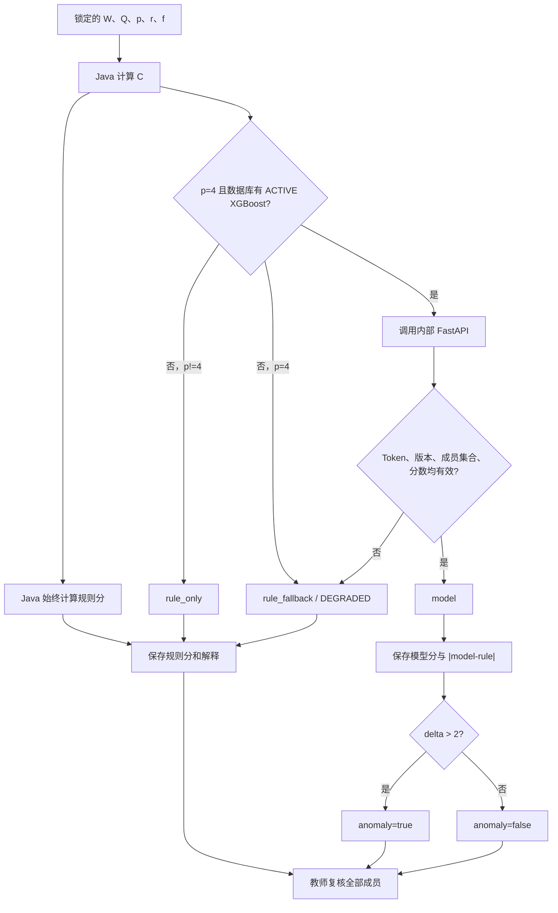

# MCQS 与 XGBoost 差异化评分说明

本文档说明论文公式如何映射到当前系统、系统对论文歧义采用了什么固定决策，以及规则分、模型分、教师最终分之间的边界。它既是实现说明，也是校园使用时的算法治理基线。

论文出处：

- MCQS 与公式（1）：PDF 第 7 页（正文第 6 页）。
- 组规模系数、基准分和个人分公式（2）–（7）：PDF 第 8 页（正文第 7 页）。
- `p=4` 的两段贡献修正：PDF 第 10 页（正文第 9 页）。
- XGBoost 训练与指标：PDF 第 9–11 页（正文第 8–10 页）。
- 学生估分、阈值差异复核与问卷/访谈建议：PDF 第 13 页（正文第 12 页）。

## 1. 变量与数据来源

| 符号 | 系统字段 | 含义与来源 |
|---|---|---|
| `m` | 作业分支数 | 教师创建作业时定义的评价分支数量。 |
| `W=(w_1,...,w_m)` | `assignment_parts.weight` | 各评价分支的权重，`w_i >= 0` 且 `Σw_i=1`。 |
| `Q=(q_ji)` | `workload_item.share` | 成员 `j` 在分支 `i` 的工作量份额；每个分支 `Σ_j q_ji=1`。 |
| `C=(c_1,...,c_r)` | 评分运行时计算并写入快照/结果 | 成员综合贡献度。 |
| `p` | `assignment.standard_group_size` | 标准组规模，当前业务接口限制为 1–4。 |
| `r` | 当前团队有效成员数 | 实际组规模，要求 `1 <= r <= p+1`。 |
| `f` | `submission.teacher_score` / `groupScore` | 教师先对团队作品给出的分数，范围 0–100。 |
| `s̄` | 解释 JSON 的 `baseline` | 考虑实际组规模后的团队基准分。 |
| `s_j` | `ruleScore` | 成员 `j` 的确定性规则分。 |

工作量与贡献度都是 `0..1` 的比例，不是 `0..100` 的百分数。前端可以显示百分比，但提交前必须转换回比例。

## 2. MCQS 多维贡献度

教师先给每个评价分支配置权重 `W`，再给出成员在各分支的份额矩阵 `Q`。成员贡献度为：

```text
C = Q W^T
c_j = Σ_i q_ji w_i
```

由 `Σ_i w_i=1` 和每个分支 `Σ_j q_ji=1` 可得：

```text
Σ_j c_j = 1
```

系统校验：

- 至少一个评价分支和一名成员。
- 所有权重、份额均在 `0..1`。
- 权重之和在 `1e-6` 容差内等于 1。
- 每个分支的成员集合完全相同且与有效团队成员一致。
- 每个分支的成员份额之和在 `1e-6` 容差内等于 1。

示例：两个分支权重为 `0.4, 0.6`，某成员的分支份额为 `0.75, 0.50`，则贡献度为：

```text
c = 0.75×0.4 + 0.50×0.6 = 0.60
```

## 3. 确定性规则公式

### 3.1 组规模系数

令 `d=p-r`。系统按论文公式（2）实现：

```text
α = e^(p-r) = 1,                  d = 0
α = 10(p-r),                     d ∈ {-1,1,2,3}
```

由于业务约束 `1 <= p <= 4` 且 `1 <= r <= p+1`，可出现的非零差值正好位于上述集合。

### 3.2 组规模调整后的基准分

```text
s̄ = f + α·sin(πf/100)
```

贡献中性节点为：

```text
t = 2/(p+2)
```

### 3.3 个人规则分

未应用 `p=4` 特殊变换前，论文分段公式为：

```text
                 s̄,                                            c = t
s(c) =           ((100-s̄)(c(p+2)-2))/p + s̄,                  c > t
                 s̄(p+2)c/2,                                   0 < c < t
```

系统最终把结果限制在 `[0,100]`。Spring Boot 持久化前按十进制 `HALF_UP` 保留 2 位；Python API 为计算/诊断保留到 6 位，业务权威结果仍是 Java 复算并保存的 2 位规则分。

## 4. `p=4` 两段贡献变换

论文为四人标准组给出两段贡献修正。系统在对应完整区间中先计算有效贡献度 `c'`，再把 `c'` 代入第 3.3 节的高/低公式：

```text
c' = 0.54c + 0.17,       c > 1/3
c' = 0.67c + 0.12,       c < 1/3
t  = 1/3,                p = 4
```

当 `c=t` 时不做仿射变换，直接取基准分 `s̄`。

## 5. 论文歧义与系统固定决策

论文部分文字和公式存在边界未定义或表述冲突。为保证 Java、Python、数据集和模型可复现，系统锁定如下版本假设：

| 歧义 | 系统决策 | 理由/影响 |
|---|---|---|
| `p=r` 时正文有“基准分等于团队分”的表述，但公式给 `α=e^0=1` | 保留公式：`s̄=f+sin(πf/100)` | 不擅自删去公式中的正弦项。 |
| `p=4` 的仿射变换是否只用于部分样本区间 | 高、低两条变换分别覆盖自己的完整分支 | 保证边界和训练数据生成规则一致。 |
| 论文个人分低分支写为 `0<c<t`，没有明确 `c=0` | **`p=4` 时仍应用低支变换，令 `c'=0.12` 后计算；`p!=4` 时未变换低公式给出 0** | 这是系统版本假设，不应描述为论文原文结论。例：`p=r=4,f=80,c=0` 的 Java 规则分约为 `29.01`，不是 0。 |
| 公式可能产生区间外值 | 最终限制到 `[0,100]` | 与论文声明的成绩范围一致。 |
| 论文只训练四人标准组 | XGBoost 只用于 `p=4`；其他 `p` 明确为 `rule_only` | 不把模型外推到无证据组规模。 |
| 阈值浮点相等 | Java 在绝对误差 `1e-6` 内视为中性节点 | 防止序列化小数导致错误分支。 |

这些决策属于评分规则版本的一部分。修改任何一项都必须创建新规则版本并重新生成测试数据与模型，不能覆盖旧运行。

## 6. 双轨评分与回退



### 6.1 模式

| `mode` | 条件 | 建议分 |
|---|---|---|
| `model` | `p=4`，模型成功返回且通过 Java 校验 | 模型分 |
| `rule_fallback` | `p=4`，模型未激活、Token 未配置、服务异常、产物/版本不匹配或响应无效 | 规则分 |
| `rule_only` | `p!=4`，模型不在适用范围 | 规则分 |

当前运行状态语义：

- `p=4` 且未得到可用模型批次：`DEGRADED`，但已经有可复核、可发布的规则结果。
- 得到可用模型批次：`MODEL_COMPLETE`。
- `p!=4` 的正常规则运行也记为 `MODEL_COMPLETE`；结果解释中的 `mode=rule_only` 才是更精确的单人模式。

### 6.2 Java 对模型响应的校验

当前 Java 要求：

- Python 返回的 `ruleVersion` 与 Java `PaperScoringEngine.RULE_VERSION` 完全相同。
- Python 返回的 `modelVersion` 与数据库激活版本完全相同。
- Python 返回的 `artifactSha256` 与数据库激活版本登记的模型文件哈希完全相同；Python 启动时也校验 metadata、manifest 与实际文件三者一致。
- 返回成员数量和成员 ID 集合与本次贡献度集合完全相同。
- 批次内每个 `modelScore` 都非空、为有限数且位于 `0..100`。

任一批次校验不通过时整批拒绝并使用规则分，避免同一团队混用不同契约的模型结果。模型服务异常不会中断规则评分。

模型—规则绝对偏差：

```text
delta = |modelScore - ruleScore|
anomaly = delta > 2
```

严格大于 2 才异常，等于 2 不异常。无论是否异常，教师都必须复核本次运行的全部成员。

## 7. XGBoost 实现与可复现性

### 7.1 训练数据

`backend/algorithm-service/app/dataset.py` 确定性重建论文式 `p=4` 合成数据：

- 团队分 `f`：`0,5,...,100`，21 个值。
- 对 `r=2..5`，贡献度 `c`：`0,0.05,...,1`，21 个值；每个 `r` 为 441 条。
- 对 `r=1`，贡献度固定为 1，共 21 条。
- 总计 `4×441+21=1785` 条。

标签由同一确定性规则公式生成，不是真实课堂教师标注。

### 7.2 特征与训练

由于模型只覆盖 `p=4`，XGBoost 实际特征顺序为：

```text
[contribution, actual_group_size, group_score]
```

HTTP 请求和 Java 输入快照仍保留 `standardGroupSize`，用于适用性判断和完整审计，但不进入当前 Booster 特征矩阵。

训练脚本固定随机种子 `2025`，按 `actual_group_size` 做确定性分层，保留 20%（356 条）作为 holdout，其余 1429 条用于训练；另在训练集上执行 5 折确定性分层交叉验证。当前签入产物使用固定、可复现参数：

```json
{
  "objective": "reg:squarederror",
  "eval_metric": "rmse",
  "learning_rate": 0.04,
  "max_depth": 6,
  "min_child_weight": 0.5,
  "subsample": 1.0,
  "colsample_bytree": 1.0,
  "reg_alpha": 0.0,
  "reg_lambda": 1.0,
  "random_state": 2025,
  "n_jobs": 1,
  "tree_method": "hist",
  "n_estimators": 800
}
```

训练脚本已经实现可选的 `BayesSearchCV` 路径：`--search --search-iterations N` 使用固定种子、5 折分层 CV 和 `neg_root_mean_squared_error` 搜索超参数。但当前签入产物的 `metadata.search.requested=false`、`executed=false`，它使用上述已签入固定参数；不能宣称本次产物实际跑过贝叶斯搜索。

产物：

- `xgboost-model.json`：XGBoost 原生 JSON，不使用 pickle。
- `metadata.json`：规则版本、模型版本、特征顺序、种子、参数、数据集哈希。
- `metrics.json`：holdout 与 5 折交叉验证的 RMSE、MAE、R²；只度量对规则标签的拟合。
- `sha256.json`：产物哈希清单。
- `synthetic-samples.csv`：可审计训练数据。

服务加载时验证必需文件、SHA-256 和特征顺序；缺文件、哈希不符、XGBoost 依赖缺失或加载失败时进入规则回退。

### 7.3 当前仓库模型的准入状态

当前仓库中的模型产物是可复现实验产物，身份信息为：

```text
modelKey     = paper-score-p4
version      = xgb-p4-seed2025-172a3cf9486e
artifactUri  = algorithm-service://artifacts/xgboost-model.json
modelSha256  = 172a3cf9486e2fa88c0d37c0401844521abdf426a6f17bf66271edb2154c162d
status       = ELIGIBLE
```

其 holdout 指标为：

```text
RMSE = 0.4828993804
MAE  = 0.3568366849
R²   = 0.9997004404
```

5 折交叉验证均值为：

```text
RMSE mean = 0.7660122624
MAE  mean = 0.5253206909
R²   mean = 0.9992587296
```

Spring 管理端准入阈值为 `RMSE<=1.0`、`MAE<=0.8`、`R²>=0.99`，优先读取 `holdout`，其次 `test`，最后顶层指标。该产物已达到阈值，`metrics.json` 与 `metadata.json` 均标记 `ELIGIBLE`，可以按受控注册流程进入数据库 `VALIDATED` 状态。`ELIGIBLE` 是产物评估结论，`VALIDATED/ACTIVE/RETIRED` 是平台生命周期状态，两者不可混写。

达到离线指标不等于已经在生产中激活：仍须核对特征顺序、URI、SHA-256、算法服务实际加载版本和 Java 响应校验，之后由管理员显式激活。无论模型是否达标，确定性规则分始终保留，模型失败时继续回退。

## 8. 快照、解释与审计

每次运行保存：

- 作业、团队、提交、规则版本、模型版本。
- 按键排序规范化后的原始输入 JSON、整批输入 SHA-256；同一业务输入不受 Java Map 构造顺序或进程重启影响。
- 每名学生的特征 JSON 和特征 SHA-256。
- `contribution`、`groupScore`、`ruleScore`、可选 `modelScore`、`modelRuleDelta`、`anomaly`、`finalScore`。
- 规则解释与教师复核原因。

当前解释 JSON 包含：

```json
{
  "ruleVersion": "...",
  "branch": "LOW_CONTRIBUTION | BASELINE | HIGH_CONTRIBUTION",
  "baseline": 80.587785,
  "threshold": 0.333333,
  "contribution": 0.62,
  "effectiveContribution": 0.5048,
  "p4AffineTransformApplied": true,
  "mode": "model | rule_fallback | rule_only",
  "modelExplanation": "xgboost_prediction",
  "assumption": "Printed paper formula; p=4 affine transforms apply to the full corresponding intervals"
}
```

教师复核时必须覆盖本次运行全部成员。最终分与建议分相差超过 `0.005` 时原因必填。发布后学生看到的是教师复核后的 `finalScore`，不是模型自动决定的分数。

## 9. 申诉与人工治理

系统已实现：

- 仅本人已发布成绩可申诉。
- 申诉期为发布后 7 天。
- 同一成绩最多一个 `SUBMITTED/PROCESSING` 的未结申诉。
- 教师只处理本人作业申诉。
- 结论只能为 `ACCEPTED` 或 `REJECTED`；接受时必须给出 `0..100` 的调整后分数。
- 接受申诉时向 `score_revision` 追加 `previousScore/revisedScore/reason/teacher`，不覆盖原始已发布 `score_result`；学生查询取最新有效修订。
- 申诉、处理结论和调整均写审计事件。

论文还建议学生先估分，系统分与估分超过阈值时申请复核，并对高差异团队汇总问卷/访谈。当前系统没有学生预估分字段、问卷或访谈模块；这属于**团队后续**，不能声称已实现。

## 10. 能力边界与公平性声明

- 当前 XGBoost 的标签完全由规则公式合成，所以模型本质上是规则函数的近似器，不是独立的“公平性证明”。
- 高 R² 只说明模型拟合合成规则，不代表真实教学场景中公平、无偏或能识别实际贡献。
- `Q` 仍来自人工分配与成员确认；错误或受压迫的确认会直接影响贡献度。界面必须让异议可见，教师必须核验证据。
- 不应使用姓名、性别、籍贯、家庭情况等与任务贡献无关的敏感特征训练模型。
- 校园正式使用前应由课程教师、教学管理人员和学生代表共同评审规则解释、申诉流程和异常阈值。
- 算法或模型更新必须保留旧版本和旧快照，不能重算并覆盖已发布成绩。

## 11. 变更规则

任何公式、容差、边界、特征顺序、训练数据、阈值或模型产物变更，都要同时完成：

1. 创建新规则/模型版本，不覆盖旧版本。
2. 更新 Java `PaperScoringEngine` 与测试。
3. 更新 Python `rules.py`、数据集固定哈希、API 测试与模型运行时。
4. 重新生成 CSV、模型、metadata、metrics、SHA-256。
5. 确认 Java 与 Python 的边界样例一致。
6. 更新本文件和 `API_CONTRACT.md`。
7. 在非生产副本中完成回退、异常、复核和申诉闭环验证后再激活。

相关命令：

```powershell
Set-Location backend\algorithm-service
python -m scripts.generate_dataset
python -m scripts.train_model --output-dir artifacts
pytest -q

Set-Location ..
mvn test
```

命令列在这里是验收要求，不代表未来修改已自动通过。
