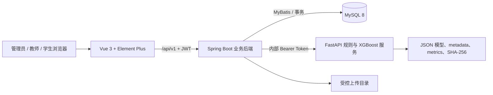
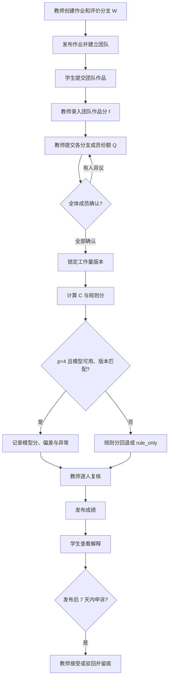
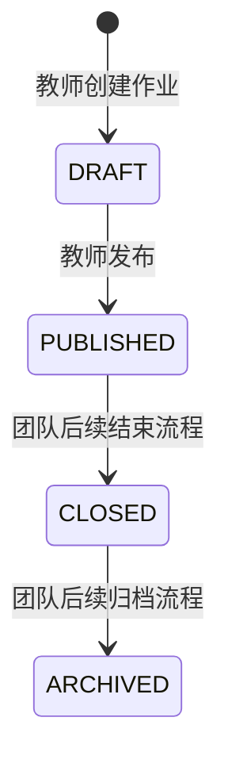
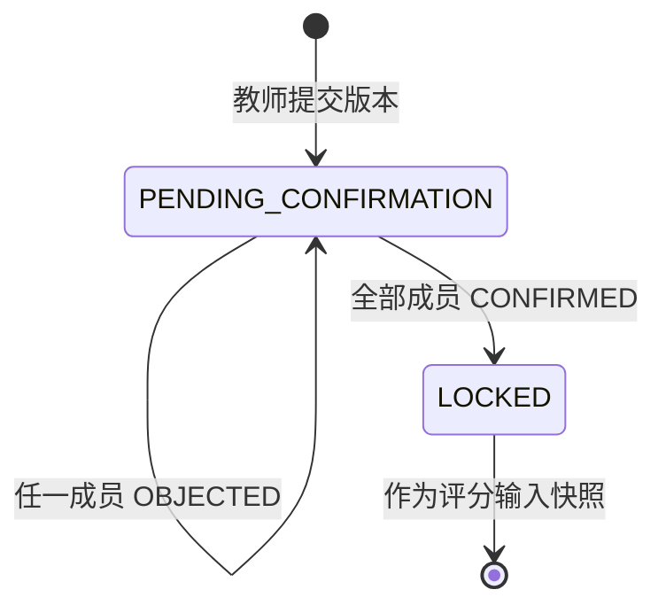
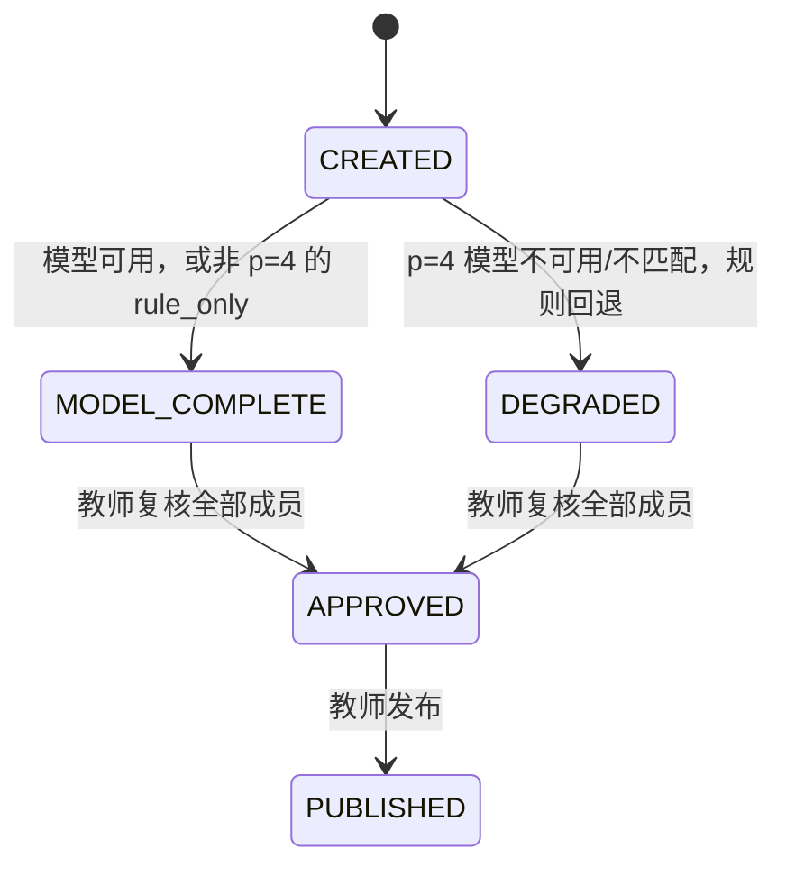
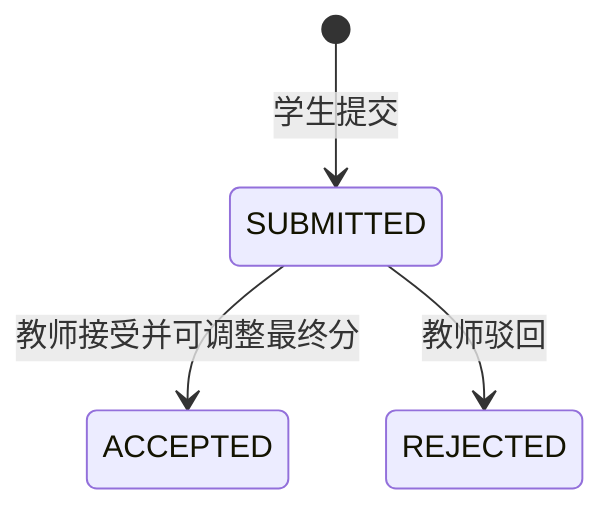

# 团队作业差异化评分系统设计

本文档是三端协作的产品与技术蓝图。它以当前仓库源码为准，并使用以下标记：

- **已实现**：仓库中已有可调用的前端页面、Java 接口或算法实现。
- **后端已实现**：Java 接口已存在，但对应教师端或学生端页面尚未制作。
- **团队后续**：当前仓库没有完整实现，不应在前端用假数据伪装完成。

更细的接口字段见 [API_CONTRACT.md](./API_CONTRACT.md)，评分公式与模型策略见 [SCORING_ALGORITHM.md](./SCORING_ALGORITHM.md)。

## 1. 产品定位

本系统服务于校园合作学习中的团队作业差异化评分。它不是通用教务系统，也不应继续堆叠与核心流程无关的管理功能。系统只围绕一条可审计的闭环建设：

1. 教师定义作业评价分支及其权重 `W`。
2. 教师记录各成员在每个分支上的工作量份额 `Q`，成员逐一确认。
3. 系统计算多维贡献度 `C = QW^T`。
4. 系统始终计算确定性规则分；标准组规模 `p=4` 时可并行给出 XGBoost 建议分。
5. 教师复核每名成员的结果后发布。
6. 学生查看解释并在规定期限内申诉，教师处理后留下审计记录。

核心原则：

- **后端权威**：权限、状态流转、公式、最终分和审计均以后端为准，前端不重新实现评分公式。
- **人工最终负责**：模型输出是建议，不直接成为不可更改的最终成绩。
- **可解释、可回退**：规则分永远保留；模型不可用时仍可完成评分。
- **最小权限**：管理员管平台基础数据与运行治理，教师管自己的教学对象，学生只访问自己的课程、团队与成绩。
- **数据最少化**：不因“以后可能用到”而收集额外个人信息。

## 2. 当前实现范围

| 层 | 当前状态 | 说明 |
|---|---|---|
| 管理员前端 | **已实现** | 登录、工作台、组织与账号、教学数据、评分模型与异常、审计日志，共 5 个主页面。 |
| 教师前端 | **团队后续** | 只有统一布局与开发占位页；业务页面不得视为完成。 |
| 学生前端 | **团队后续** | 只有统一布局与开发占位页；业务页面不得视为完成。 |
| Spring Boot 后端 | **已实现核心闭环** | JWT、三角色鉴权、账号治理、课程/作业/团队/提交、成员与附件读取、工作量确认、评分、复核、发布、申诉、成绩修订与审计接口已存在，可直接支撑教师端和学生端页面开发。 |
| Python 算法服务 | **已实现** | 论文规则、MCQS 贡献计算、可选 XGBoost、Bearer 内部鉴权、模型失败回退。 |
| MySQL 数据层 | **已实现** | 生产核心结构、种子元数据与 Flyway 迁移；部署前仍须按部署文档在空库或旧库路径中二选一。 |
| 文件存储 | **已实现上传与受控下载** | 本地受控目录上传与 SHA-256；下载按管理员、上传者或课程/作业/团队/成绩关系鉴权，尚无内联预览与删除。 |

## 3. 总体架构

职责边界：

- Vue 只负责展示、表单校验、交互和调用接口。
- Spring Boot 负责身份、角色和资源归属校验、业务状态机、事务、确定性规则复算、模型响应校验、最终分与审计。
- FastAPI 是只允许 Spring Boot 调用的内部计算服务。它不连接业务数据库，也不决定最终成绩。
- MySQL 保存业务事实、输入快照、规则分、模型分、最终分、版本号与申诉记录。
- 模型文件必须与数据库中的模型版本、哈希和特征顺序一致；只在数据库“激活”记录并不能替换 Python 进程已加载的文件。

## 4. 核心业务流程

业务约束：

- 一个作业的分支权重之和必须为 `1`。
- 每个分支必须包含完整且相同的团队成员集合；该分支成员份额之和必须为 `1`。
- 实际组员数必须满足 `1 <= r <= p + 1`，当前作业创建接口限制 `1 <= p <= 4`。
- 只有全体成员 `CONFIRMED` 的工作量版本才能锁定并用于评分。
- 同一输入快照与同一模型版本不能重复发起相同评分运行。
- 教师必须提交本次运行全部成员的复核决定；调整算法建议分时必须填写原因。
- 学生只能看到 `PUBLISHED` 的成绩。

## 5. 页面设计

### 5.1 通用页面与组件

| 页面/能力 | 状态 | 说明 |
|---|---|---|
| `/login` | **已实现** | 用户名、密码登录；`role` 可省略，由后端在三类账号中识别唯一账号。 |
| `/change-password` | **已实现** | 首次登录必须修改临时密码；页面不可通过路由跳过，成功后清除会话并要求使用新密码重新登录。 |
| 角色路由守卫 | **已实现** | 管理员、教师、学生只能进入自己的路径前缀。 |
| 顶部账号菜单 | **已实现** | 展示当前用户、修改密码、退出登录。 |
| 统一错误处理 | **已实现** | 解析统一响应；401 清理本地会话并返回登录页。 |

### 5.2 管理员端

管理员只做平台治理，不代替教师处理日常教学。

| 路由 | 页面 | 状态 | 必要职责 |
|---|---|---|---|
| `/admin/dashboard` | 工作台 | **已实现** | 展示师生、课程、作业、评分运行、异常、申诉和当前模型等关键状态；只做概览和入口。 |
| `/admin/organization` | 组织与账号 | **已实现** | 查看院系—专业—班级结构；检索、新增、编辑、启停和重置师生账号；支持 UTF-8 CSV 模板导入，逐行展示成功、失败和临时密码。 |
| `/admin/teaching-data` | 教学数据 | **已实现** | 全局只读检索课程与作业数量；教学操作仍由教师端完成。 |
| `/admin/scoring-model` | 评分模型 | **已实现** | 查看模型版本、准入指标、评分运行和模型/规则偏差异常；按生产契约注册模型，激活或回滚已验证版本，并记录异常处理说明。 |
| `/admin/audit-logs` | 审计日志 | **已实现** | 按事件、角色、日期和关键字查询关键业务事件；前端不提供删除。 |

新增单个账号后临时密码会在当前结果中明确展示；批量导入报告也会逐账号返回临时密码。管理员必须安全交付，不能把临时凭据写入共享文档或日志。模型激活仅改变平台登记状态，不能替代算法服务制品部署与版本/哈希核对。

明确不在管理员端继续增加的内容：教师作业编辑、团队分配、作品评分、工作量确认、最终成绩修改和学生申诉业务处理。这些均属于教师端。

### 5.3 教师端页面蓝图

当前 `/teacher/dashboard` 是开发占位页。团队应按下表顺序实现，不需要复制旧草稿页面。

| 建议路由 | 页面 | 状态 | 页面职责与现有后端能力 |
|---|---|---|---|
| `/teacher/dashboard` | 教师工作台 | **团队后续** | 聚合待发布作业、待评分提交、待确认工作量、待复核运行和待处理申诉。当前没有专用聚合接口，第一版可由业务列表组合，后续再补聚合接口。 |
| `/teacher/courses` | 我的课程 | **团队后续** | 使用 `GET /teacher/courses` 展示本人课程；不可查看或修改其他教师课程。 |
| `/teacher/courses/:courseId/assignments` | 课程作业 | **团队后续** | 查看、创建并发布作业。创建时编辑评价分支、权重、标准组规模和截止时间，实时提示权重和必须为 1。 |
| `/teacher/assignments/:assignmentId/groups` | 团队管理 | **团队后续** | 查看和建立该作业团队，使用课程学生候选接口筛选未入组学生，并通过受归属校验的成员接口展示组长和成员。 |
| `/teacher/assignments/:assignmentId/submissions` | 提交与团队评分 | **团队后续** | 查看提交正文、附件 `storageKey` 和说明；通过受鉴权文件接口下载附件，录入 `0..100` 团队作品分和评语。 |
| `/teacher/assignments/:assignmentId/workload` | 工作量分配 | **团队后续** | 按评价分支给每名成员分配份额和证据；每列合计为 1；提交后等待成员确认。 |
| `/teacher/scoring-runs/:runId` | 差异化评分复核 | **团队后续** | 展示贡献度、团队分、规则分、模型分、偏差、异常和解释；要求逐人确认，人工改分必须填理由。 |
| `/teacher/appeals` | 成绩申诉 | **团队后续** | 查看本人作业的申诉；接受时填写调整后分数和处理说明，驳回时填写说明。 |

教师端不得：在浏览器中自己计算最终分、跳过工作量全员确认、自动发布模型建议分、查看其他教师数据、把模型不可用误报成评分失败。

### 5.4 学生端页面蓝图

当前 `/student/dashboard` 是开发占位页。

| 建议路由 | 页面 | 状态 | 页面职责与现有后端能力 |
|---|---|---|---|
| `/student/dashboard` | 学生工作台 | **团队后续** | 汇总待提交作业、待确认工作量、新发布成绩和申诉期限。当前没有专用聚合接口。 |
| `/student/courses` | 我的课程 | **团队后续** | 使用 `GET /student/courses` 查看有效选课，并进入已发布作业。 |
| `/student/courses/:courseId/assignments` | 课程作业 | **团队后续** | 展示 `PUBLISHED`/结束态作业及提交状态。 |
| `/student/assignments/:assignmentId/submission` | 团队作品提交 | **团队后续** | 输入正文或先上传附件后提交 `storageKey`；同一团队同一作业再次提交会更新现有提交。 |
| `/student/groups` | 我的团队 | **团队后续** | 展示本人所属团队。当前接口只给团队摘要，成员详情需补接口。 |
| `/student/assignments/:assignmentId/workload` | 工作量确认 | **团队后续** | 展示所有分支和成员份额；选择 `CONFIRMED` 或 `OBJECTED`，异议必须填写原因。 |
| `/student/scores` | 我的成绩 | **团队后续** | 只展示已发布成绩；清楚区分团队分、贡献度、规则分、模型分、教师最终分和解释。 |
| `/student/scores/:scoreResultId/appeal` | 成绩申诉 | **团队后续** | 发布后 7 天内提交理由和证据。当前没有“我的申诉列表”接口，提交后状态回看需补接口。 |

学生端不得展示未发布结果，不得把 `modelScore` 写成“系统最终分”，也不得在前端推测其他成员的隐藏信息。

## 6. 业务状态机

### 6.1 作业与提交

当前 Java 控制器只实现 `DRAFT -> PUBLISHED`。数据库还兼容 `ACTIVE/ENDED/CLOSED/ARCHIVED`，但结束与归档接口属于**团队后续**；当前学生列表读取 `PUBLISHED/CLOSED`。学生提交只接受 `PUBLISHED` 且未超过截止时间的作业；提交状态由 `SUBMITTED` 经教师评分变为 `GRADED`，成绩是否发布另有标记。

### 6.2 工作量确认

异议不会自动改份额。教师应根据异议提交一个新版本；“旧版本自动标记 `SUPERSEDED`”目前未由 Java 服务完成，属于后续增强。

### 6.3 评分运行与结果

数据库允许 `PENDING_REVIEW` 和 `FAILED`，但当前同步评分服务没有主动写入这两个状态。单人成绩在当前 Java 流程中依次为 `DRAFT -> REVIEWED -> PUBLISHED`。管理员的异常治理另用 `anomaly_status=PENDING/RESOLVED`，不会篡改教师成绩复核状态。

### 6.4 申诉

数据库预留 `PROCESSING`、`CANCELLED`，当前控制器没有对应操作。

## 7. 核心数据模型

| 聚合 | 主要表 | 关键事实 |
|---|---|---|
| 账号与组织 | `admin_users`、`teacher_users`、`student_users`、`department`、`major`、`class`、`user_account_view` | 三类账号物理分表，统一视图输出 `ADMIN/TEACHER/STUDENT`；密码只存 BCrypt。 |
| 课程与作业 | `course`、`student_course`、`assignment`、`assignment_parts` | `assignment_parts.weight` 保存 `W`；作业保存标准组规模和规则版本引用。 |
| 团队与提交 | `group_table`、`group_member`、`submission` | 团队绑定具体作业；一个学生在同一作业只应属于一个有效团队。 |
| 工作量 | `workload_set`、`workload_item`、`workload_confirmation` | `workload_item.share` 保存 `Q`；版本锁定后才可评分。 |
| 评分 | `scoring_rule`、`model_version`、`scoring_run`、`scoring_input_snapshot`、`score_result` | 输入快照、特征哈希、规则/模型版本、双轨分数、最终分和解释全部持久化。 |
| 申诉与审计 | `score_appeal`、`audit_event` | 申诉与关键状态变更可追踪；审计事件不由普通业务页面删除。 |
| 文件 | 本地 `STORAGE_ROOT` | 数据库/业务请求只保存返回的 `storageKey`；实际文件位于受控目录。 |

## 8. 安全、隐私与审计

- API 使用短期 JWT Access Token 和轮换 Refresh Token；Refresh Token 在数据库只存 SHA-256。
- Spring Security 按 `/api/v1/admin/**`、`/teacher/**`、`/student/**` 强制角色隔离，服务层继续校验资源归属。
- Access Token 声明中的角色为 `ADMIN/TEACHER/STUDENT`；前端内部可标准化为 `ROLE_*`，但不能据此前端判断替代后端鉴权。
- Access/Refresh Token 均绑定账号 `tokenVersion`；退出、停用/启用、管理员重置密码和用户修改密码都会递增版本，使旧 Token 立即失效。
- 每次请求都有 `X-Request-Id`；业务审计应关联请求号、操作者、聚合对象和最少必要上下文。
- 反向代理必须覆盖客户端传入的转发头；Spring/Tomcat 只接受内部可信代理转发后的客户端地址，生产禁止公网直连 8080。
- Python `/v1/*` 必须使用内部 Bearer Token，并只监听内网或回环地址。
- 上传限制为白名单扩展名，下载已有业务关系鉴权；仍应在校园正式使用前增加恶意文件扫描、保留期限和必要的内联预览策略（**团队后续**）。
- `PasswordChangeRequiredFilter` 对 `mustChangePassword=true` 的账号只放行 `/auth/me`、`/auth/change-password`、`/auth/logout`；前端路由同样强制进入 `/change-password`，改密成功后清会话并要求重新登录。
- 成绩、工作量证据、申诉和审计属于敏感教学数据；生产数据库、备份和上传目录必须限制访问并加密传输。

## 9. 可选增强项与后续优先级

核心评分闭环所需读取和写入接口已经实现。下列项目不阻塞教师端/学生端首版开发，也不能由前端假数据伪装：

| 优先级 | 缺口 | 影响 |
|---|---|---|
| P2 | 教师/学生工作台聚合接口 | 第一版可组合现有列表；聚合可减少请求数。 |
| P2 | 文件内联预览、删除与保留策略 | 受控下载已实现，生命周期治理仍需校园制度。 |
| P2 | 工作量版本关系可视化 | 新方案会使开放旧版本 `SUPERSEDED`，可补时间线页面。 |
| P2 | 作业结束/归档接口 | 不影响作业创建、提交、评分与发布闭环。 |
| P2 | 通知、消息、导出、模型审批工作流 | 不影响核心评分闭环，后续按校园需求补充。 |

新增接口时必须先更新 `API_CONTRACT.md`，再实现后端和测试，最后开发页面。

## 10. 团队开发边界

1. 不修改论文公式、阈值、歧义决策或版本字符串来“配合页面”；算法变更必须独立评审并同时更新 Java、Python、测试、模型产物和本文档。
2. 不直接更新评分表来跳过状态机；必须调用服务方法并产生审计事件。
3. 不在前端保存第二套角色 Token、第二套 API 响应格式或第二套评分状态名称。
4. 教师端和学生端优先复用 `frontend/src/api/http.js`、Pinia 会话、共享布局与通用组件；业务 API 分模块新增。
5. 不把旧截图、旧页面或旧表字段当成当前契约；以当前 Java DTO、控制器、迁移和本文档为准。
6. 所有列表必须有加载、空状态、错误与权限失败处理；不能在接口错误时展示伪造统计值。
7. 最终合并前按 [TEAM_HANDOFF.md](./TEAM_HANDOFF.md) 完成端到端验收。
